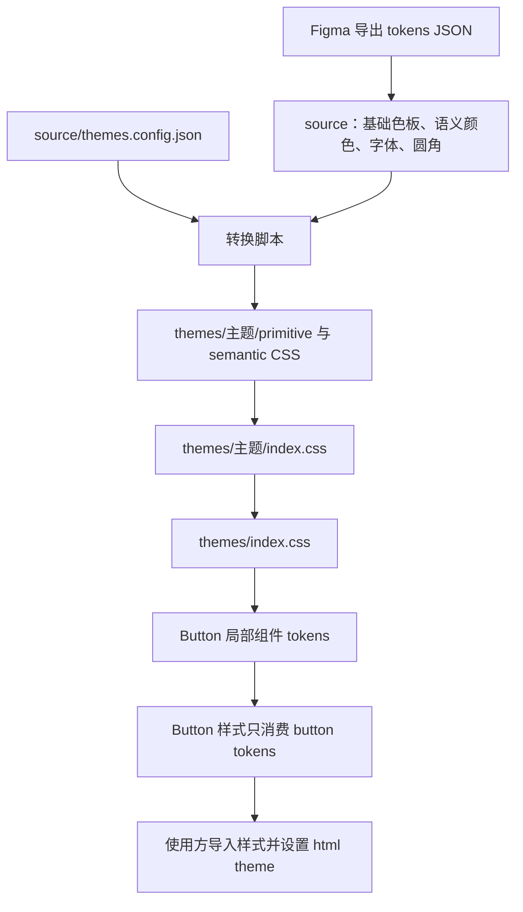

# bkui-factory

`bkui-factory` 是 `@bkreact/ui` 的组件库工程，目前已完成 Figma tokens 到多主题 CSS 的生成、入口汇总和校验。已提供基于 Base UI 的 Button，Tailwind 映射及 npm 包发布链路仍在搭建中。

项目将设计数据、转换程序、主题产物和组件类型分开维护。设计变量修改后，通过脚本更新 CSS；业务页面使用带有视觉用途的 semantic 变量，组件通过自身的局部 tokens 映射 semantic。

## 目录与职责

```text
.
├── source/                         # Figma 导出的原始 tokens 与主题配置
│   ├── themes.config.json          # 默认主题配置
│   ├── primitives/
│   │   ├── light/                  # 浅色主题基础色板
│   │   └── dark /                  # 深色主题基础色板，当前目录名带尾部空格
│   └── semantic/
│       ├── light/                  # 浅色主题语义颜色
│       ├── dark /                  # 深色主题语义颜色
│       ├── English.tokens.json     # 英文字体及共用排版设置
│       ├── 中文.tokens.json        # 中文字体及共用排版设置
│       ├── Numeric.tokens.json     # 数字字体及共用排版设置
│       └──  radius.tokens.json     # 共用圆角，当前文件名带前导空格
├── .storybook/                     # Storybook 配置、主题工具栏和示例布局
├── docs/                           # 项目介绍与设计变量展示
├── scripts/
│   ├── generate-theme-tokens.mjs    # 读取、转换、渲染、写入和只读校验
│   ├── generate-theme-tokens.test.mjs
│   └── button.typecheck.tsx          # Button API 的类型契约测试
├── src/
│   ├── components/
│   │   ├── themes/                 # 自动生成，修改应从 source 开始
│   │   │   ├── index.css           # 汇总所有主题
│   │   │   ├── light/
│   │   │   │   ├── index.css       # 汇总本主题的全部 token 文件
│   │   │   │   ├── primitive/colors.css
│   │   │   │   └── semantic/
│   │   │   │       ├── colors.css
│   │   │   │       ├── radius.css
│   │   │   │       └── typography.css
│   │   │   └── dark/               # 与 light 相同的输出结构
│   │   ├── types/base.ts           # 组件共用类型约定
│   │   └── button/                  # Button 实现、API、tokens、stories 与自动测试
│   ├── client.ts                    # 客户端组件导出
│   ├── index.ts                     # 服务端可使用的类型导出
│   ├── styles.css                   # 主题与组件的总样式入口
│   ├── tailwind-entry.css          # Tailwind 源码扫描入口
│   └── tailwind-preset.ts          # Tailwind 主题映射草稿
├── package.json                    # 包导出声明、依赖和 token 命令
├── yarn.lock
├── tsup.config.ts                  # 预留的组件库打包配置
├── tsconfig.json
└── postcss.config.js
```

当前导出文件中的首尾空格可以保留，脚本会在生成路径和变量名称时去掉首尾空格。它读取本地 JSON，不连接 Figma，也不负责从 Figma 下载数据。

## 架构与数据流



### 1. 设计数据层：source

脚本支持以下输入约定：

| 输入路径 | 含义 | 输出 |
| --- | --- | --- |
| `primitives/<theme>/<name>.tokens.json` | 主题基础颜色，变量类型必须为 `color` | `<theme>/primitive/<name>.css` |
| `semantic/<theme>/<name>.tokens.json` | 主题语义颜色，保留到 primitive 的引用 | `<theme>/semantic/<name>.css` |
| `semantic/English.tokens.json`、`中文.tokens.json`、`Numeric.tokens.json` | 各主题共用的字体和排版默认值 | 各主题的 `semantic/typography.css` |
| `semantic/<theme>/English.tokens.json` 等字体模式文件 | 指定主题的排版覆盖 | 该主题的 `semantic/typography.css` |
| `semantic/radius.tokens.json` | 各主题共用的圆角默认值 | 各主题的 `semantic/radius.css` |
| `semantic/<theme>/radius.tokens.json` | 指定主题的完整圆角定义 | 该主题的 `semantic/radius.css` |

`English`、`中文`、`Numeric` 是当前支持的三个字体模式文件名。它们表示英文、中文、数字使用的字体；相同的字号、行高等设置会合并，不会生成三份排版文件。

主题从输入目录中发现，无需在脚本里维护 light/dark 白名单。增加主题时，应提供它的基础色板和语义颜色；共用字体和圆角会复制到该主题。**不同主题的颜色不会互相回退**，语义颜色引用的 primitive 必须存在于同一主题中。

### 2. 转换层：scripts

[转换脚本](scripts/generate-theme-tokens.mjs) 的处理顺序为：

1. 递归查找 `.tokens.json`，识别集合、主题和变量类别。
2. 展开嵌套分组，继承分组的 `$type`，忽略作为元数据的 `$` 字段。
3. 建立各主题的 primitive 索引，再解析语义颜色引用。
4. 合并字体默认值与主题覆盖，选择主题圆角或共用圆角。
5. 渲染主题作用域和 CSS 变量，生成每个主题入口及总入口。
6. 所有输入转换与校验成功后，才开始写入文件；`--check` 模式只比较文件。

脚本导出两个程序接口：

| 接口 | 职责 |
| --- | --- |
| `buildThemeFiles({ sourceDir? })` | 返回 `Map<相对输出路径, CSS 内容>`，不写文件 |
| `generateThemes({ sourceDir?, targetDir?, check?, quiet? })` | 写入文件，或以 `check: true` 校验现有产物；返回预期输出文件的完整路径列表 |

默认输入是项目根目录下的 `source/`，默认输出是 `src/components/themes/`，不依赖执行命令时的工作目录。

校验涵盖重名、错误类型、无效颜色、悬空 primitive 引用、字体模式冲突、非法圆角和不存在的默认主题。它不提供文件系统层面的事务：写入阶段发生磁盘错误时，仍可能留下部分已更新文件。

### 3. 主题层：primitive 与 semantic

| 类别 | 变量示例 | 值的来源 |
| --- | --- | --- |
| 基础颜色 | `--theme-color-blue-500` | Figma 色值 |
| 语义颜色 | `--color-action-primary` | `var(--theme-color-blue-500)` |
| 字体 | `--font-family-zh`、`--font-family-en`、`--font-family-numeric` | 直接写字体名称 |
| 字号与行高 | `--text-base-size`、`--text-base-line-height` | 直接写带单位的数值 |
| 圆角 | `--radius-scale-md` | 直接写 `px` 数值 |

**颜色分为两层；typography 和 radius 只保留 semantic 一层。** semantic 变量不增加 `theme` 前缀。

语义颜色通过 Figma 的 `com.figma.aliasData` 获取 `targetVariableName`，生成到同主题 primitive 的 `var(...)` 引用。目标集合名称须符合当前的 `Primitive` / `Primitives` 命名，例如 `Primitives / 基础色板`。导出文件中缓存的语义色值不作为最终 CSS 值。

其他转换规则：

- 嵌套变量路径用 `-` 连接，名称转小写；驼峰、空格、斜线、下划线和点会规范化。
- 基础颜色支持六位、八位十六进制字符串，或 Figma `srgb` 对象；透明度保留为十六进制 alpha。
- 字号、行高等数字根据 Figma scopes 补 `px`；圆角统一输出 `px`，且必须为非负有限数字。
- 字体模式中的 `font.family.text` 分别转换为 `--font-family-en`、`--font-family-zh`、`--font-family-numeric`。
- 同一组字体模式的共用设置若值不同，脚本报错；主题字体设置可按变量覆盖全局默认值。
- 主题圆角文件存在时，整体替代共用圆角文件，不按单个圆角变量合并。

### 4. 组件类型层

[base.ts](src/components/types/base.ts) 定义组件的共用类型，包括尺寸、响应式断点、视觉变体、意图、布局、表单选项和生命周期接口。[button/type.ts](src/components/button/type.ts) 通过 `ButtonProps` 区分原生按钮与链接属性，包含图标、尺寸、变体、加载态和链接等属性。

[Button 实现](src/components/button/index.tsx) 负责渲染和状态，[src/client.ts](src/client.ts) 导出客户端组件，[src/index.ts](src/index.ts) 仅导出类型。原生按钮分支使用 `@base-ui/react/button`；链接分支直接渲染 `<a>`，保留原生导航语义。

## 生成与校验

仓库使用 `yarn.lock` 管理依赖。本次验证环境为 Node.js `22.13.0`、Yarn `1.22.22`；`package.json` 尚未声明 `engines`。

首次安装可执行以下命令；本次验证未单独测试全新目录安装：

```bash
yarn install --frozen-lockfile
```

依赖就绪后，在项目根目录运行：

```bash
npm run tokens:build   # 重新生成 token CSS、主题入口和总入口
npm run tokens:check   # 只读检查生成文件是否与 source 一致
npm run tokens:test    # 运行转换和主题机制的回归测试
npm run button:test    # 运行 Button DOM、组件 token 约束及示例交互测试
npm test               # 运行所有自动测试
npm run typecheck      # 检查源码与 Button API 类型契约
```

也可使用 `yarn tokens:build` 等同名命令。脚本不需要额外环境变量。

修改时先更新 `source/`，再执行生成、校验和测试。生成文件带有 `Generated by npm run tokens:build; do not edit.` 标记，不应直接手工维护。

`tokens:check` 会检查预期生成文件的缺失和内容差异，以及带有生成标记的多余 CSS；手写的其他 CSS 不纳入逐字节比较。生成命令不会自动删除旧产物，删除或重命名源文件后，应根据校验结果清理旧生成文件。

测试覆盖实际源数据的转换、生成一致性、主题隔离、字体覆盖、默认主题、入口导出完整性、引用有效性、透明度和异常输入。维护转换规则时，应同步更新这些测试。

## 组件示例与文档服务器

启动 [Storybook](https://storybook.js.org/docs/get-started/frameworks/react-vite)：

```bash
npm run dev
```

默认地址为 **http://127.0.0.1:6006**，修改组件、CSS 或 stories 后会热更新。`npm run storybook` 是同一个启动入口，关闭服务器可在运行终端按 `Ctrl+C`。

展示内容包括：

- **开始使用 / 项目介绍**：展示本 README，文档与项目说明共用一份内容。
- **组件 / Button**：可调参数用例、3 种变体与 5 种意图对照、7 档尺寸、状态和图标、链接、响应式尺寸、组件 tokens 覆盖。
- **Button 交互测试用例**：点击响应、禁用拦截、加载与焦点恢复、加载伸缩动画、表单提交。打开对应用例时会执行其 `play` 函数。
- **设计变量 / Semantic**：语义颜色、字体字号和圆角的可视化展示。

顶部工具栏可以选择默认主题、light 或 dark。主题列表从已生成的主题入口自动发现；“默认主题”会移除 `html` 的 `theme` 属性，使用 `source/themes.config.json` 对应的默认样式。可调试用例的 Controls 用于实时修改组件参数；需要检查响应式行为时，调整浏览器或 iframe 的视口宽度。

静态文档可单独构建：

```bash
npm run build:docs
```

产物位于 `.storybook-static/`，这是组件文档站点的构建，与组件 npm 包的发布构建相互独立。

### 每个组件的示例与测试约定

当前项目只有 Button 一个可渲染的公共组件。它的示例和测试位于组件目录：

```text
src/components/button/
├── index.tsx
├── type.ts
├── tokens.css
├── styles.css
├── size.ts
├── index.css
├── Button.stories.tsx              # 可视示例、参数说明和交互 play 函数
└── button.test.mjs                 # DOM 行为、样式约束及示例交互回归
```

新增组件时，在对应目录添加 `组件名.stories.tsx` 和 `组件名.test.mjs`。Storybook 自动发现 `src/components/**/*.stories.tsx`；`npm test` 自动执行 `src/components/*/*.test.mjs`，无需逐个修改服务器配置或测试命令。

示例至少包含默认状态、支持的视觉变体和尺寸、禁用与加载状态、关键交互。组件通过自身 tokens 设置样式，示例使用真实组件，避免另写一份预览实现。

Button 的五个 `play` 交互用例同时由 `npm test` 在 DOM 测试环境中执行，复用页面展示的同一份交互逻辑。它们验证行为，不替代真实浏览器中的视觉验收。

### 本地构建配置

`.storybook/main.mjs` 使用 React + Vite，并为文档站点单独配置标准 CSS 处理，不依赖尚未完成的 Tailwind/PostCSS 发布配置。

项目使用 `node_modules`。当前机器的上级目录存在其他项目的 Yarn PnP 配置，可能被 esbuild 误识别；根目录的 `.pnp.data.json` 将本项目路径排除在 PnP 解析之外，使依赖继续从本项目 `node_modules` 读取，不修改上级目录配置。

## 默认主题与使用方式

默认主题配置位于 [source/themes.config.json](source/themes.config.json)：

```json
{
  "defaultTheme": "light"
}
```

修改后需要重新生成 CSS。默认主题名称必须与生成的主题名称一致，否则脚本报错。

默认主题的所有 token 文件会使用以下作用域：

```css
html:not([theme]),
html[theme='light'] {
  /* 当前默认主题的变量 */
}
```

因此，未设置 `theme` 属性时使用默认主题；显式属性优先决定主题。`theme=""` 或不存在的主题名不会触发默认回退。若删除配置文件或不设置 `defaultTheme`，生成结果仅包含显式主题选择器。

在支持 CSS 导入的应用中，导入本仓库的主题总入口即可使用所有主题。下面以应用入口位于本项目 `src/` 下为例，路径需随使用位置调整：

```ts
import './components/themes/index.css';
```

需要只加载一种主题时，可导入对应的 `light/index.css` 或 `dark/index.css`。仅导入非默认主题时，需要显式设置匹配的 `theme` 属性。

```html
<!-- 不设置属性：使用配置中的默认主题 -->
<html>

<!-- 显式使用深色主题 -->
<html theme="dark">
```

浏览器中可以切换或恢复默认主题：

```js
document.documentElement.setAttribute('theme', 'dark');
document.documentElement.removeAttribute('theme');
```

组件样式使用 semantic 变量，例如：

```css
.example-card {
  background: var(--color-surface-container);
  color: var(--color-text-primary);
  border-radius: var(--radius-scale-md);
  font-family: var(--font-family-zh);
  font-size: var(--text-base-size);
  line-height: var(--text-base-line-height);
}
```

字体 tokens 仅声明字体名称，项目没有提供字体文件或自动加载字体的代码。主题机制也不包含本地存储、跟随系统配色或运行时主题管理器，这些由应用接入时决定。

## Button 与组件 tokens

源码使用示例（相对路径以项目根目录为例；发布构建完成前不使用 npm 包名导入）：

```tsx
import { Button } from './src/client';
import './src/styles.css';

<Button intent="info" variant="fill" onClick={() => console.log('提交')}>提交</Button>;
<Button intent="success" variant="line" size={{ sm: 'xs', lg: 'lg' }}>响应式尺寸</Button>;
<Button link="/account" target="_blank" rel="noreferrer">账户</Button>;
<Button loading>提交中</Button>;
```

`src/styles.css` 导入所有主题及 Button、Icon、Loading 样式。Button 和 Loading 自身也导入局部样式；直接导入组件时仍需接入主题样式，以提供 semantic 变量。

| API | 支持值与默认行为 |
| --- | --- |
| `intent` | `normal`（默认）、`info`、`success`、`warning`、`error` |
| `variant` | `fill`（默认）、`line`、`ghost` |
| `size` | `2xs` / `xs` / `sm` / `base`（默认）/ `lg` / `xl` / `2xl`，或响应式尺寸对象 |
| `block` / `round` | 默认关闭；分别设置整行宽度、胶囊圆角 |
| `prefixIcon` / `suffixIcon` | 文案前后图标，作为装饰内容隐藏于辅助技术；loading 时前置图标由 `Loading type="normal"` 替换 |
| `disabled` / `loading` | 默认关闭；均阻止激活，loading 保留文案与后置图标，显示 Loading 并设置 `aria-busy` |
| `link` | 存在时渲染原生链接，支持 `target`、`rel`；禁用或加载时移除 `href` 并拦截点击 |
| `type` | 原生按钮默认 `button`，显式 `submit` 才用于表单提交 |
| `ref` / `onClick` | 根据是否提供 `link`，分别对应 `HTMLAnchorElement` 或 `HTMLButtonElement` |

响应式尺寸的断点为 `sm: 40rem`、`md: 48rem`、`lg: 64rem`、`xl: 80rem`、`2xl: 96rem`。移动端默认使用 `base`，未设置的断点沿用较小断点的值，无需 JavaScript 监听窗口。

进入和退出 loading 时，前置槽位以 `--button-loading-duration`（默认 `200ms`）和 `--button-loading-easing`（默认 `ease`）平滑展开或收起，无需测量按钮宽度。已有前置图标时原位替换；整行按钮保持整行宽度。非加载状态不渲染 Loading，减少动态效果偏好会关闭过渡。

loading 中的原生按钮通过 Base UI 保留焦点；`disabled` 则使用原生 disabled。图标按钮需由使用方提供 `aria-label`。Loading 遵循 `prefers-reduced-motion`，键盘焦点使用可见 outline。

组件 tokens 分层参考 [Bootstrap Button 局部 CSS 变量](https://getbootstrap.com/docs/5.3/components/buttons/#css)：

```text
primitive 颜色 → semantic 颜色 ─┐
semantic 字体、圆角 ────────────┴→ button/tokens.css → button/styles.css
```

- [tokens.css](src/components/button/tokens.css)：定义所有 `--button-*`，包括颜色、状态、尺寸、图标、焦点、加载槽位过渡和响应式尺寸的默认值；这是 Button 到 semantic 的映射入口。旋转动画由 Loading 管理。
- [styles.css](src/components/button/styles.css)：样式属性只消费 `--button-*`，不直接读取 semantic 或 primitive 变量。intent 和 variant 修改局部 tokens，统一的状态规则消费它们。
- [size.ts](src/components/button/size.ts)：根据 `size` 生成内部 `--button-*` 引用，响应式切换交由媒体查询完成。

组件颜色直接映射已有 semantic tokens，不使用 `color-mix` 或其他方式派生颜色。主操作按钮使用 `action-primary` 的默认、hover 和 active 语义色；success、warning、error 尚无独立的 hover/active 语义色，因此复用各自的反馈色。line、ghost 的交互背景使用 `fill-hover` 和 `fill-active`。新增状态色应先在设计 tokens 中定义。

使用方可以通过业务 class 覆盖 Button tokens，不必修改主题文件：

```css
/* 放在组件样式之后。 */
.my-action {
  --button-border-radius: 8px;
  --button-bg: var(--color-action-primary);
  --button-hover-bg: var(--color-action-primary-hover);
}
```

组件行为依据 [Base UI Button](https://base-ui.com/react/components/button)；链接保留原生 `<a>`，不通过 Base UI 的 `render` 属性模拟链接。

## Loading 与组件 tokens

```tsx
import { Loading } from './src/client';
import './src/styles.css';

<Loading />;
<Loading type="rect" size={32} fillColor="var(--color-action-link)" speed={1200} />;
<Loading type="logo" size="xl" />;
<Loading size={{ sm: 'xs', lg: 'lg', '2xl': '2xl' }} />;
```

`type` 默认为 `normal`，复用 `BKIcon name="loader"` 的旋转动画；`rect` 使用五根错峰伸缩的柱子；`logo` 使用 BitKan Logo 原始路径，从左到右显现、停留后淡出。

`size` 支持与 Button 相同的七档尺寸、响应式对象，以及像素数值。七档高度依次为 12、14、16、18、20、22、24px，默认为 `base`（18px）；Logo 按其 `1024 / 300` 比例计算宽度。响应式断点和逐级回退规则与 Button 一致。

`fillColor` 默认继承当前文字颜色；`speed` 是一次循环的毫秒数，normal、rect、logo 默认分别为 800、1000、3320ms。无效速度回退到类型默认值。组件支持原生 span 属性和 ref，默认以 `role="status"`、名称“加载中”提供状态语义；父组件已处理加载提示时，可传入 `aria-hidden` 避免重复播报。

- [tokens.css](src/components/loading/tokens.css)：定义 `--loading-*` 尺寸、颜色、动画和圆角映射。
- [styles.css](src/components/loading/styles.css)：仅消费 Loading tokens；包含响应式尺寸和减少动态效果规则。
- [size.ts](src/components/loading/size.ts)：生成尺寸 token 引用。
- [logo.tsx](src/components/loading/logo.tsx)：保留原始 Logo 路径，使用独立裁剪 ID，支持同页多个实例和服务端水合。

通过业务 class 或 `style` 覆盖 `--loading-size`、`--loading-color`、`--loading-duration` 可以定制样式。Button 只在 loading 时渲染 normal Loading，并将其尺寸绑定到 `--button-icon-size`，沿用按钮的文字颜色。

验证命令：`npm run loading:test`、`npm run button:test`、`npm run typecheck`。Storybook 的“组件/Loading”包含三种动画、全部尺寸、响应式、颜色/速度、组件 tokens 及 Button 集成示例。

## 构建配置与当前缺口

[package.json](package.json) 声明的包名是 `@bkreact/ui`，仅将 `dist/` 纳入发布文件，并将 CSS 标记为具有副作用。以下是当前的导出声明，**尚不能据此认为这些发布产物已经可用**：

| 包导出 | 预期产物 |
| --- | --- |
| `@bkreact/ui` | `dist/index.js`、`index.cjs`、`index.d.ts` |
| `@bkreact/ui/client` | `dist/client.js`、`client.cjs`、`client.d.ts` |
| `@bkreact/ui/styles.css` | `dist/styles.css` |
| `@bkreact/ui/tailwind.css` | `dist/tailwind-entry.css` |
| `@bkreact/ui/tailwind-preset` | `dist/tailwind-preset.js` |
| `@bkreact/ui/safelist.css` | `dist/safelist.css` |

配置及未完成部分如下：

| 文件或模块 | 当前状态 |
| --- | --- |
| [tsup.config.ts](tsup.config.ts) | 配置了 ESM/CJS、类型声明、source map 和 React 外置依赖；入口为 `src/index.ts`、`src/client.ts`。尚未提供完整 npm build 命令及样式发布流程 |
| [tsconfig.json](tsconfig.json) | 配置严格模式和 React JSX；`include` 覆盖 `src/` 和 Button API 类型测试；使用已安装的 TypeScript 执行 `npm run typecheck` |
| [postcss.config.js](postcss.config.js) | 声明 Tailwind PostCSS 与 `autoprefixer`；`autoprefixer` 未列入项目依赖，当前环境也未安装 |
| [src/tailwind-entry.css](src/tailwind-entry.css) | 目前只有 `@source "./"` 扫描声明，没有接入主题总入口 |
| [src/tailwind-preset.ts](src/tailwind-preset.ts) | `yourPreset` 仍引用 `--primary`、`--radius` 占位变量，与当前 token 名称尚未对齐 |
| 主题类型 | `IBKTheme` 当前为 `'black' \| 'light'`，实际生成的主题为 `dark` / `light`，后续需要统一 |
| 样式发布 | 当前没有生成或复制上述 `dist` 样式、preset 和 safelist 的完整流程 |

当前可直接使用并验证的是源码 Button、主题 CSS 和 token 工具链。发布组件库前，需要补齐 Tailwind 映射及完整打包产物。

## 维护原则

- 视觉契约使用“视觉用途”，不绑定具体元素：例如使用 `surface-container`、`text-primary` 表达用途。
- 区分值变化与契约变化：主题色值调整保持变量名稳定；变量新增、删除、重命名时，检查使用方和类型约定。
- 设计数据、转换规则、生成产物分别维护；修改规则后运行一致性校验和回归测试。
